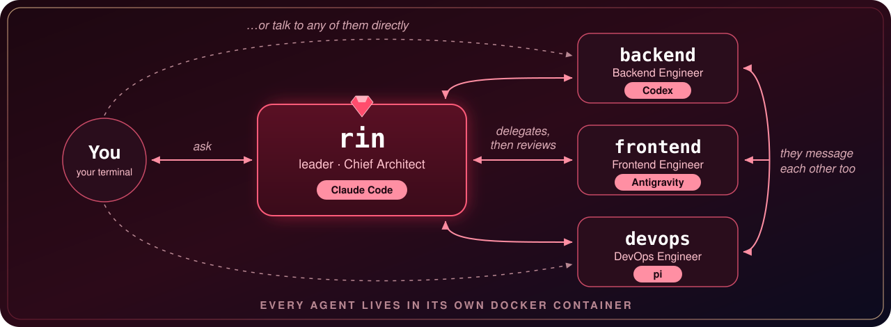

<div align="center">



<br><br>

**One config file. One command. A whole team of AI agents on your machine.**

_「 You write the config. I'll take care of the rest. 」_

<br>


<br>

[Prologue](#-prologue) &nbsp;✦&nbsp; [The cast](#-the-cast) &nbsp;✦&nbsp; [The summoning](#-the-summoning) &nbsp;✦&nbsp; [Spellbook](#-spellbook) &nbsp;✦&nbsp; [House rules](#-house-rules)


</div>

## 🌙 Prologue

<sup>EPISODE 1 ・ 第一話</sup>

One AI agent is handy. A whole **team** of them, with an architect who plans, engineers who build, and everyone talking to each other, gets a lot more done. Putting that team together by hand is the boring part.

**Rin** (yes, _that_ Tohsaka) does the boring part. You describe your team in one file, and she brings it to life on your own machine:

- 🏠 &nbsp;**A room for everyone.** Each agent lives in its own Docker container and keeps its home when the team restarts.
- 🧠 &nbsp;**Any brain you like.** Each agent runs Claude Code, Codex, Antigravity or pi. Mix them freely in one team.
- 👑 &nbsp;**One leads, everyone talks.** A leader splits up the work and hands it out. You can still talk to any agent yourself, and they can message each other.
- 🔁 &nbsp;**Same team, every time.** The same config brings back the same team, on any machine.

> _"Don't get the wrong idea. I'm not doing this for you. A good team simply deserves a proper setup."_<br>
> — Rin, probably

## 🎭 The cast

<sup>EPISODE 2 ・ 第二話</sup>

The example in [`examples/team`](examples/team) stars four agents:



|     | Agent          | Role                                                                                           | Runs        |
| :-: | :------------- | :--------------------------------------------------------------------------------------------- | :---------- |
| 👑  | **`rin`**      | **Chief Architect.** Leads the team: breaks work down, delegates, and reviews what comes back. | Claude Code |
| ⚙️  | **`backend`**  | **Backend Engineer.** Owns APIs, data and services.                                            | pi          |
| 🎨  | **`frontend`** | **Frontend Engineer.** Owns the user interface.                                                | Codex       |

The casting is up to you. Every agent is a few lines in `rin.yml`:

```yaml
agents:
  - id: rin
    type: leader
    label: Chief Architect
    harness: claude-code
    authentication: subscription
    model: claude-opus-5-5
    resources: { cpus: 2, ram: 4g }
```

…plus an `INSTRUCTIONS.md` that tells them who they are and what they own. The [full example config](examples/team/rin.yml) is a good place to start.

## 🔮 The summoning

<sup>EPISODE 3 ・ 第三話</sup>

> _"A proper magus prepares before the ritual."_

**What you need:** [Docker](https://docs.docker.com/get-started/get-docker/) with Compose 2.24 or later (Docker Desktop, or Docker Engine with the Compose plugin), and Rust's [`cargo`](https://rustup.rs/) to install Rin.

### 1 ・ Summon Rin

```sh
cargo install --git https://github.com/w3lt/rin --tag v0.1.0 tohsaka
```

The package is called `tohsaka`. The command you get is `rin`.

### 2 ・ Hand over the keys

Only for agents that use an API key. Agents that sign in with a subscription skip this step. The example team's `backend` uses a key, so it needs `ANTHROPIC_API_KEY` here.

```sh
mkdir -p -m 700 ~/.rin && touch ~/.rin/keys.env && chmod 600 ~/.rin/keys.env
cat >> ~/.rin/keys.env <<'EOF'
ANTHROPIC_API_KEY=...
EOF
```

Only Bifrost, the gateway that API-key agents go through, reads this file.

### 3 ・ Draw the circle

```sh
cd examples/team                      # in a clone of this repo
rin generate --instructions agents
```

Rin checks `rin.yml`, picks up each agent's `INSTRUCTIONS.md` from `agents/`, and prepares the team in `~/.rin/teams/my-team`. It becomes your current team.

### 4 ・ Wake the team

```sh
rin up
```

The first run builds the images, so there is time for tea. ☕

### 5 ・ Say hello

Agents on a subscription need you to sign in once. Step into their room and run their own tool (`claude` for Rin, `codex` for `frontend`):

```sh
rin shell rin
```

After that, you can message her from anywhere:

```sh
rin send rin "Reply with exactly: pong"
```

### 6 ・ Watch them work, then send everyone home

```sh
rin status     # who is up, and how busy they are
rin log -f     # follow the team's conversation
rin down       # good night, everyone
```

`rin down` keeps every agent's home and the message log, so nothing is lost before the next `rin up`. (｡•̀ᴗ-)✧

## 📜 Spellbook

<sup>EPISODE 4 ・ 第四話</sup>

| Spell                               | What it does                                                                     |
| :---------------------------------- | :------------------------------------------------------------------------------- |
| `rin generate --instructions <dir>` | Checks `rin.yml` and prepares the team. Makes it the current team.               |
| `rin up`                            | Starts the team. Builds the images the first time.                               |
| `rin down`                          | Stops the team. Homes and the message log are kept.                              |
| `rin shell <id>`                    | Opens a shell in an agent's container.                                           |
| `rin send <id> "<text>"`            | Messages an agent and prints its reply.                                          |
| `rin agents`                        | Lists the team's agents.                                                         |
| `rin status`                        | Shows each agent's state, sessions and queues, and warns about deadlocks.        |
| `rin log [-f] [<id>]`               | Shows the message history. `-f` keeps following, `<id>` narrows it to one agent. |
| `rin use <name>`                    | Switches the current team.                                                       |

## 🏯 House rules

<sup>EPISODE 5 ・ 第五話</sup>

- **Rin remembers your team.** Every command except `generate` acts on the current team, from any directory. Add `--team <name>` to pick another one, or `rin use <name>` to switch.
- **One team at a time.** Only one team can be up at once (each publishes its hub on `127.0.0.1:10302`).
- **Agents talk among themselves.** Inside their containers they message each other with the `send_message` and `list_agents` MCP tools (Claude Code, Codex, Antigravity), or with `rin send <id> "<text>"` and `rin agents` (pi).
- **Want the full story?** The design and success criteria live in [issue #1](https://github.com/w3lt/rin/issues/1).

## 🛠️ For fellow magi

<sup>EXTRA ・ 番外編</sup>

<details>
<summary><b>Working on Rin itself</b> (the technical part)</summary>

<br>

```sh
scripts/verify_code.sh         # fmt, clippy, tests (incl. hub/runtime end to end with a fake harness), image build
scripts/verify_code.sh matrix  # + clippy on every feature subset; what the pre-commit hook runs
scripts/verify_docker.sh       # needs Docker: a throwaway team up and down, images built from HEAD as pushed
git config core.hooksPath .githooks   # once per clone, to enable the hooks
```

The binary has three feature sets: `host` (default: the commands above),
`hub` (`rin hub`) and `agent` (`rin runtime`, `rin mcp`). Images build Linux
`rin` with `--no-default-features --features hub,agent`.

Images build `rin` from the `v<version>` tag. To try unreleased changes, point
them at another revision when generating, e.g.
`RIN_GIT_REV=refs/heads/my-branch rin generate --instructions agents`. Docker
caches that build step by its command line, so after pushing new commits to
the same branch rebuild with
`docker compose -p rin-<name> -f ~/.rin/teams/<name>/docker-compose.yml build --no-cache`
(or use a commit hash as the revision).

</details>

<div align="center">


Licensed under MIT or Apache-2.0, whichever you prefer.

_She is the best waifu, btw._ &nbsp;(๑•̀ㅂ•́)و✧

<sub>A fan-named project, not affiliated with or endorsed by TYPE-MOON. The artwork in this README is original.</sub>

</div>
